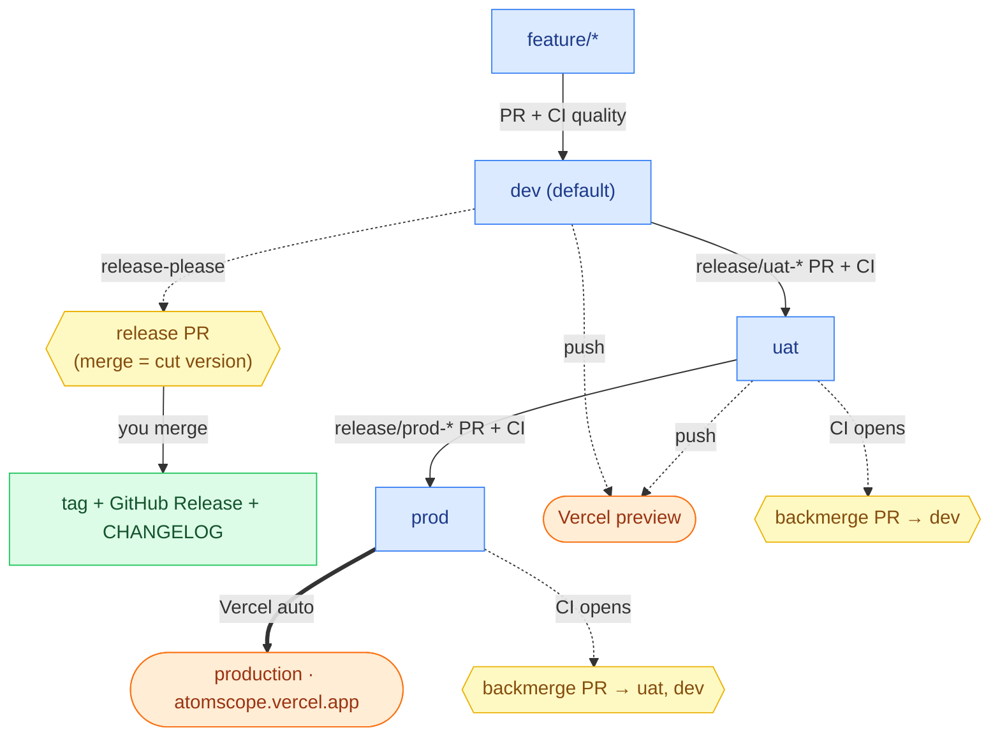

# Branch flow & release mechanism

> 🟦 branch · 🟩 CI 自動 · 🟨 **你人工 merge** · 🟧 Vercel 部署

## Mechanism (what triggers what)

| Trigger                               | What runs                                                                | Auto?                                         |
| ------------------------------------- | ------------------------------------------------------------------------ | --------------------------------------------- |
| push `dev`/`uat`/`prod` **or** any PR | **quality**: format → lint → test → build → size                         | 🟩 CI                                         |
| push `dev`                            | **release-please** keeps a release PR (version + `CHANGELOG`)            | 🟩 CI opens / 🟨 you merge to cut the release |
| push `uat` / `prod`                   | **backmerge**: opens fan-out PRs (`uat→dev`; `prod→uat,dev`)             | 🟩 CI opens / 🟨 you merge                    |
| push to any branch                    | **Vercel** builds & deploys — `prod` = production, `dev`/`uat` = preview | 🟧 Vercel (external, not in Actions)          |

- **Versioning is on `dev`** (release-please). `uat`/`prod` deploy the dev-cut version — they don't release.
- **All merges are manual** (yours). CI only _opens_ PRs; it never merges.
- **No `deploy-*.yml`** — Vercel handles deploy. **No PreTag/hotfix build gate** (that's the Azure-DevOps/MGM model; here the version lives on `dev`).

## Branches

| branch          | role                                          |
| --------------- | --------------------------------------------- |
| `dev` (default) | integration; release-please cuts version here |
| `uat`           | acceptance / staging (preview)                |
| `prod`          | production — Vercel production branch         |

## Branch naming

`feat/<slug>` · `fix/<slug>` · `refactor/<slug>` → PR into `dev`
`release/uat-YYMMDD-<slug>` (from `dev` tip) → PR into `uat`
`release/prod-YYMMDD-<slug>` (from `uat` tip) → PR into `prod`
`hotfix/uat-<slug>` (from `uat`) · `hotfix/prod-<slug>` (from `prod`) → PR into that env

## Promote → release (PR + squash, CI green)

- **dev → uat**: cut `release/uat-*` from `dev` tip → PR into `uat` → you merge → merge the `uat→dev` backmerge PR.
- **uat → prod**: cut `release/prod-*` from `uat` tip → PR into `prod` → you merge → Vercel ships production → merge the `prod→uat` + `prod→dev` backmerge PRs.
- Merge backmerge PRs before the next promote, or branches drift (phantom conflicts).

See [RUNBOOK.md](RUNBOOK.md) for copy-paste commands.
