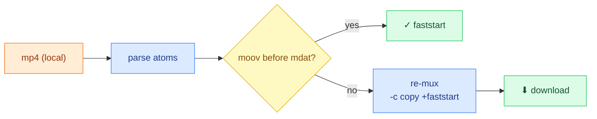

# AtomProbe

**English · [中文](README.zh-TW.md)**


> Inspect an mp4's atom layout, see whether it's **faststart**, and re-mux **`+faststart`** in one click — **100% in the browser, nothing uploaded.**
>
> **Live demo:** <https://atomprobe.vercel.app/> · **Desktop:** see [Releases](https://github.com/RemyJerrie1/AtomProbe/releases) for Windows `.msi` / macOS `.dmg`


## Highlights

- **One-click `+faststart` re-mux, fully in-browser** — real ffmpeg.wasm, `-c copy` (lossless), zero upload, zero backend.
- **Shows _why_ an mp4 won't stream** — top-level atom order (`ftyp/moov/mdat`) + `moov` offset + faststart ✓/✗ verdict.
- **PWA installable + offline-capable** — service worker precaches the app shell; works without a network connection after first load.
- **Desktop app via Tauri (~10 MB)** — native window wrapper, no Electron, no bundled Chromium.
- **Production-grade, not a toy** — TS strict · ESLint/Prettier · husky · Vitest · Lighthouse · GitHub Actions CI.



## Quick start

```bash
npm install
npm run dev      # dev server (http://localhost:5173)
npm run build    # static build → dist/
npm test         # unit tests
```

## How faststart works

`moov` is the index a player needs to demux (tracks, timeline, per-frame byte offsets). With `moov` **before** `mdat`, the player reads the index from the first few KB and uses **HTTP Range Requests** to stream only what it plays — no full download. `+faststart` just relocates `moov` to the front (post-mux, no re-encode, byte-identical media).

## Architecture decisions

**Vite SPA, not Next.js** — every feature runs in the browser with no server interaction; Next's SSR/SSG/RSC/SEO surface adds a server runtime and hydration overhead that buys nothing here. Counter-example: dynamic OG images or server-side data fetching → use Next.js.

**COOP/COEP/CORP security headers** — `Cross-Origin-Opener-Policy: same-origin` and `Cross-Origin-Embedder-Policy: require-corp` unlock `SharedArrayBuffer`, which ffmpeg.wasm requires for multi-threaded re-mux. Headers are set on both the Vercel production edge and the Vite dev server so the security boundary is consistent across environments. Counter-example: embedding third-party iframes that don't opt into CORP — those would need a different isolation strategy.

**ffmpeg.wasm excluded from service worker precache** — the wasm binary is ~30 MB, far above Workbox's 2 MB precache limit; including it would cause SW installation to fail and block PWA installability entirely. Instead, wasm is served `NetworkOnly` and re-fetched on each session. Counter-example: a small self-hosted wasm under 5 MB where offline re-mux is a hard requirement — then cache it with `CacheFirst` and accept the SW install cost.

**Tauri for desktop, not Electron** — Tauri wraps the OS-native webview (WebView2 on Windows, WebKit on macOS), producing a ~10 MB installer versus Electron's ~150 MB bundled Chromium. AtomProbe has no Node.js native API requirements and no WebGL/WebCodecs behavior that demands a pinned Chromium version. Counter-example: an app requiring consistent Chromium rendering across platforms or deep Node.js integration → Electron.

**Monorepo for `src-tauri/`** — `main.rs` is a ~5-line window shim with no independent business logic, release cycle, or crates.io API surface; a separate repo would add overhead with no benefit. Counter-example: a Tauri plugin with its own Rust API published to crates.io — then split.

**Single-thread ffmpeg.wasm (current)** — `-c copy` re-mux is fast enough on a single thread for the files this tool targets. COOP/COEP headers are already in place, so upgrading to multi-thread requires only a config change in a future release. Counter-example: batch processing large files where single-thread latency is unacceptable → switch to `@ffmpeg/ffmpeg` multi-thread mode.

## Desktop install

Download the latest release from [Releases](https://github.com/RemyJerrie1/AtomProbe/releases):

| Platform              | File             | Note                                                                                        |
| --------------------- | ---------------- | ------------------------------------------------------------------------------------------- |
| Windows               | `.msi` installer | Run and install normally                                                                    |
| macOS (Apple Silicon) | `.dmg`           | Binary is unsigned — if Gatekeeper blocks it: `xattr -d com.apple.quarantine AtomProbe.dmg` |

## Quality & CI

| Area         | Tooling                                                                 |
| ------------ | ----------------------------------------------------------------------- |
| Types        | TypeScript strict                                                       |
| Lint         | ESLint 9 · Prettier                                                     |
| Tests        | Vitest + v8 coverage (atom parser)                                      |
| Hooks        | husky — pre-commit `lint-staged` · pre-push tests                       |
| Metrics      | `npm run metrics:size` · `npm run metrics:lhci`                         |
| CI (web)     | GitHub Actions: format → lint → test → build → size (push / PR)         |
| CI (desktop) | `release-tauri.yml`: Windows + macOS matrix, triggered on `v*` tag push |

---

<sub>**Stack:** React 19 · TypeScript · Vite 6 · `@ffmpeg/ffmpeg` (WASM) · vite-plugin-pwa (Workbox) · Tauri 2. **Limitations:** top-level atoms only · mp4 only · large files bound by browser memory · macOS binary unsigned.</sub>
