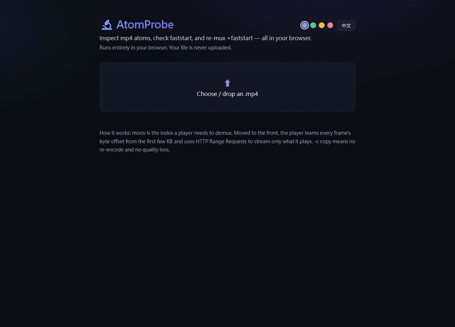
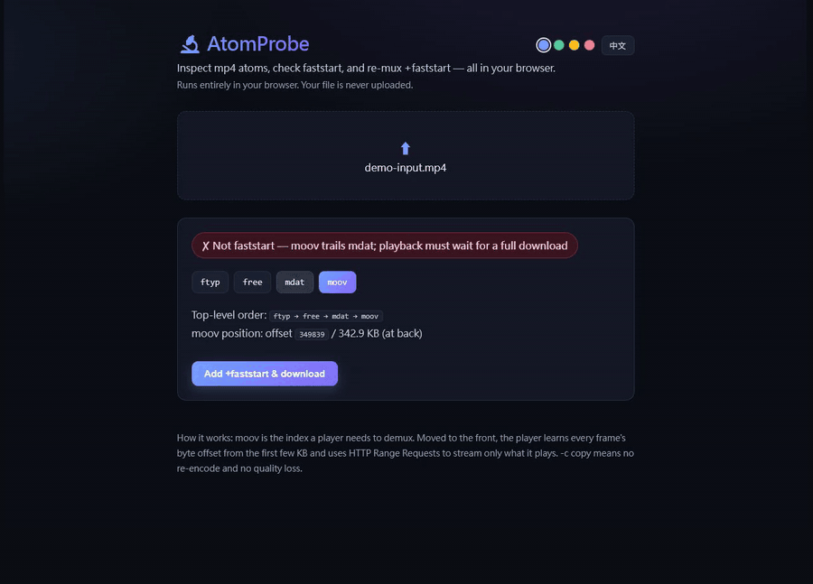
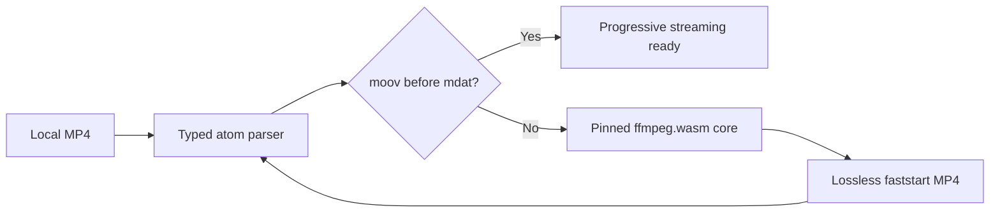

# AtomProbe

**See why an MP4 cannot start streaming — then repair it without uploading the file.**

[Live demo](https://atomprobe.vercel.app/) · [Desktop releases](https://github.com/RemyJerrie1/AtomProbe/releases) · [繁體中文](README.zh-TW.md)

[](https://github.com/RemyJerrie1/AtomProbe/actions/workflows/ci.yml)   

<a href="./docs/media/system-workflow.mp4"></a>

The workflow above is the real application at runtime: import → inspect → repair request → verify. No camera zoom or mock UI.

## What the system proves

| Capability              | Runtime evidence                                                                       |
| ----------------------- | -------------------------------------------------------------------------------------- |
| Binary inspection       | Parses top-level MP4 atoms and exposes their actual byte order and `moov` offset       |
| Streaming diagnosis     | Distinguishes `moov → mdat` faststart files from `mdat → moov` download-first files    |
| Local repair            | Runs a pinned single-thread ffmpeg.wasm core with `-c copy -movflags +faststart`       |
| Privacy boundary        | Media bytes stay inside the browser; there is no upload endpoint or processing backend |
| Cross-platform delivery | Ships as a PWA and a lightweight Tauri desktop application                             |

## Runtime walkthroughs

### 1. Analyze atom order

<a href="./docs/media/analyze-workflow.mp4"></a>

The parser identifies `ftyp → free → mdat → moov`, reports the byte offset, and explains why playback waits for more of the file.

### 2. Repair and verify

<a href="./docs/media/repair-workflow.mp4"></a>

The UI invokes lossless remuxing, then the repaired output is re-imported and verified as `ftyp → moov → free → mdat`.

### 3. Design system in production

AtomProbe now separates semantic tokens from reusable React primitives:

```text
src/design-system/
├── tokens.css       color, spacing, radius, motion, elevation
├── primitives.css   Surface, StatusBadge, ActionButton
└── primitives.tsx   typed React components
```

Indigo, emerald, amber, and rose themes change semantic accent tokens without duplicating component rules. Run `npm run check:design-system` to prevent token-order and primitive-usage regressions.

## Architecture



The ffmpeg core is version-pinned and self-hosted under `public/vendor`, removing a runtime CDN dependency. `npm run sync:ffmpeg-core` refreshes those assets from the installed package.

> **Why there is no Bruno collection:** AtomProbe intentionally has no HTTP API. An invented API collection would be misleading, so executable parser tests, asset pinning, design-system checks, CI, and browser runtime captures provide the contract evidence instead.

## Run locally

```bash
npm install
npm run sync:ffmpeg-core
npm run dev
```

Quality gates:

```bash
npm run lint
npm run test:run
npm run check:design-system
npm run build
npm run metrics:size
```

<details>
<summary><strong>Engineering decisions</strong></summary>

- **Vite SPA:** every feature runs locally; a server-rendered runtime adds no product value.
- **Single-thread ffmpeg.wasm:** `-c copy` remuxing avoids re-encoding and does not require `SharedArrayBuffer`.
- **WASM excluded from service-worker precache:** the ~32 MB core would make installation expensive; it is self-hosted and fetched on demand.
- **Tauri over Electron:** the desktop build reuses the operating-system webview instead of bundling Chromium.
- **Parser scope:** top-level MP4 atoms are intentional; deeply nested codec inspection belongs in a different diagnostic tool.

</details>

<details>
<summary><strong>Desktop installation</strong></summary>

Download `.msi` or `.dmg` packages from [Releases](https://github.com/RemyJerrie1/AtomProbe/releases). The current macOS package is unsigned, so Gatekeeper may require manual approval.

</details>

<sub>React 19 · TypeScript strict · Vite 6 · ffmpeg.wasm · Vitest · PWA · Tauri 2</sub>
