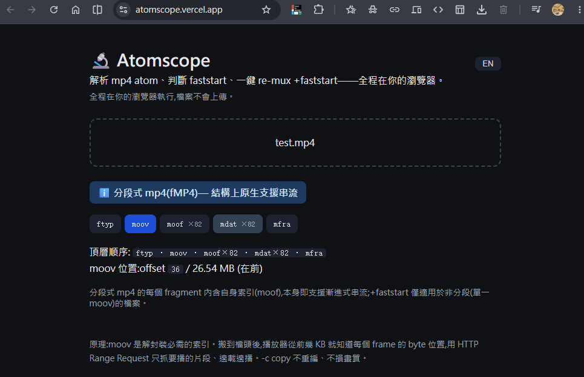
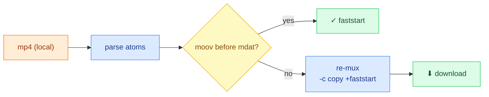

# 🔬 Atomscope

**English · [中文](README.zh-TW.md)**


> Inspect an mp4's atom layout, see whether it's **faststart**, and re-mux **`+faststart`** in one click — **100% in the browser, nothing uploaded.** · **Live demo:** <https://atomscope.vercel.app/>



## ✨ Highlights

- ⚡ **One-click `+faststart` re-mux, fully in-browser** — real ffmpeg.wasm, `-c copy` (lossless), **zero upload, zero backend**.
- 🔍 **Shows _why_ an mp4 won't stream** — top-level atom order (`ftyp/moov/mdat`) + `moov` offset + faststart ✓/✗ verdict.
- 🧠 **Deliberate design, documented** — Vite SPA over Next.js, single-thread WASM (no COOP/COEP), client-only — each a real trade-off (see below).
- ✅ **Production-grade, not a toy** — TS strict · ESLint/Prettier · husky hooks · Vitest · Lighthouse · GitHub Actions CI.



## Quick start

```bash
npm install
npm run dev      # dev server
npm run build    # static build → dist/
npm test         # unit tests
```

## How faststart works

`moov` is the index a player needs to demux (tracks, timeline, per-frame byte offsets). With `moov` **before** `mdat`, the player reads the index from the first few KB and uses **HTTP Range Requests** to stream only what it plays — no full download. `+faststart` just relocates `moov` to the front (post-mux, no re-encode, byte-identical media).

## Design decisions

<details>
<summary>Why Vite SPA (not Next.js) · single-thread ffmpeg · client-only · no AI in v1</summary>

- **Vite SPA, not Next.js** — 100% client-side; Next's SSR/SSG/RSC/SEO value doesn't apply and would only add a server runtime + hydration cost. _Counter-example:_ dynamic OG/SSR → use Next.
- **Single-thread ffmpeg.wasm** — multi-thread needs `SharedArrayBuffer` + COOP/COEP, complicating static hosting; `-c copy` re-mux is fast enough.
- **`-c copy`** — relocates `moov` only; bitstream untouched → fast, lossless.
- **Client-only, no upload** — privacy + zero backend. _Cost:_ bounded by browser memory for huge files.
- **No AI in v1** — cloud AI needs a key/backend, breaking client-only. A future on-device WebGPU LLM could explain reports while staying backend-free.

</details>

## Quality & CI

| Area    | Tooling                                                         |
| ------- | --------------------------------------------------------------- |
| Types   | TypeScript strict                                               |
| Lint    | ESLint 9 · Prettier                                             |
| Tests   | Vitest + v8 coverage (atom parser)                              |
| Hooks   | husky — pre-commit `lint-staged` · pre-push tests               |
| Metrics | `npm run metrics:size` · `npm run metrics:lhci`                 |
| CI      | GitHub Actions: format → lint → test → build → size (push / PR) |

---

<sub>**Stack:** React 19 · TypeScript · Vite 6 · `@ffmpeg/ffmpeg` (single-thread WASM). **Limitations:** top-level atoms only · mp4 only · large files bound by browser memory.</sub>
