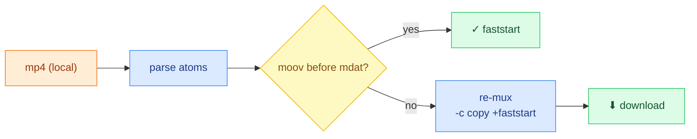

# 🔬 Atomscope


> Inspect an mp4's atom layout, see whether it's **faststart**, and re-mux **`+faststart`** in one click — **100% in the browser, nothing uploaded.**

**Live demo:** _(deploy pending)_ · **Screenshot:** _(todo)_

## Why

A streaming mp4 starts playing instantly only when its `moov` index sits **before** `mdat` ("faststart"). Atomscope shows the atom order, flags whether it's faststart, and fixes it — without sending your file anywhere.

## What it does

- Parse top-level atoms (`ftyp / moov / mdat / free`) and show their order.
- Flag **faststart ✓ / ✗** and the `moov` byte offset.
- One-click re-mux to `+faststart` via ffmpeg.wasm (`-c copy`, no re-encode), then download.



## Quick start

```bash
npm install
npm run dev      # dev server
npm run build    # static build → dist/
npm test         # unit tests
```

## Quality gates

| Area    | Tooling                                                         |
| ------- | --------------------------------------------------------------- |
| Types   | TypeScript strict                                               |
| Lint    | ESLint 9 · Prettier                                             |
| Tests   | Vitest + v8 coverage (atom parser)                              |
| Hooks   | husky — pre-commit: `lint-staged` · pre-push: tests             |
| Metrics | `npm run metrics:size` · `npm run metrics:lhci` (Lighthouse)    |
| CI      | GitHub Actions: format → lint → test → build → size (push / PR) |

## Design decisions

<details>
<summary>Why Vite SPA (not Next.js), single-thread ffmpeg, client-only, no AI in v1…</summary>

- **Vite SPA, not Next.js** — 100% client-side (atom parsing + ffmpeg.wasm run in-browser, nothing uploaded). Next's value (SSR/SSG/RSC/SEO) doesn't apply here; it would only add a server runtime + hydration cost. _Counter-example:_ a tool needing dynamic OG meta / SSR would use Next.
- **Single-thread ffmpeg.wasm** — multi-thread needs `SharedArrayBuffer` + COOP/COEP (cross-origin isolation), which complicates static hosting and third-party resources; a single-file `-c copy` re-mux is fast enough single-threaded.
- **`-c copy` (no re-encode)** — faststart only relocates the `moov` atom; the bitstream is untouched → fast, no quality loss, content byte-identical.
- **Client-only, no upload** — privacy + zero backend + instant. _Cost:_ bounded by browser memory for very large files (a deliberate trade-off).
- **No AI in v1** — cloud AI would need a key/backend, breaking client-only. A future **on-device WebGPU LLM** ("explain this report") could add AI while staying backend-free — knowing _when not_ to add AI matters as much as when to.

</details>

## How faststart works

`moov` is the index (tracks, timeline, per-frame byte offsets) a player needs to demux. With `moov` at the front, the player learns every position from the first few KB and uses **HTTP Range Requests** (`GET bytes=x-y`) to fetch only what it plays — no full download. `+faststart` moves `moov` to the front in a post-mux pass, without re-encoding.

## Limitations

Top-level atoms only (no recursive box tree); mp4 only; large files bound by browser memory.

## Tech

React 19 · TypeScript · Vite 6 · `@ffmpeg/ffmpeg` (single-thread WASM core).
