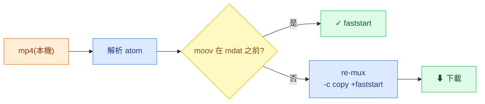

# AtomProbe

**[English](README.md) · 中文**


> 檢視 mp4 的 atom 結構、判斷是不是 **faststart**，並一鍵 re-mux 加上 **`+faststart`** —— **全程在瀏覽器、檔案不上傳。**
>
> **線上 demo:** <https://atomprobe.vercel.app/> · **桌機版:** 見 [Releases](https://github.com/RemyJerrie1/AtomProbe/releases)，提供 Windows `.msi` / macOS `.dmg`


## 亮點

- **一鍵 `+faststart` re-mux，全在瀏覽器** —— 真的 ffmpeg.wasm，`-c copy`（無損）、零上傳、零後端。
- **看得出影片「為什麼不能串流」** —— 頂層 atom 順序（`ftyp/moov/mdat`）+ `moov` 位置 + faststart ✓/✗ 判定。
- **PWA 可安裝 + 離線可用** —— Service Worker 預快取 app shell；首次載入後無網路也能使用。
- **Tauri 桌機版（~10 MB）** —— 原生 webview 包裝，不用 Electron，不捆綁 Chromium。
- **production-grade，不是玩具** —— TS strict · ESLint/Prettier · husky · Vitest · Lighthouse · GitHub Actions CI。



## 快速開始

```bash
npm install
npm run dev      # 開發伺服器（http://localhost:5173）
npm run build    # 靜態打包 → dist/
npm test         # 單元測試
```

## faststart 的原理

`moov` 是播放器解封裝（demux）必需的索引（軌道、時間軸、每個 frame 的 byte 位置）。當 `moov` 在 `mdat` **之前**，播放器讀前幾 KB 就拿到索引，再用 **HTTP Range Request** 只抓當下要播的片段 —— 不必整支下載。`+faststart` 只是把 `moov` 搬到檔頭（封裝後處理、不重編、音視訊內容完全不變）。

## 架構決策

設計取捨的完整英文說明見 [README.md](README.md#architecture-decisions)。以下為中文摘要。

**Vite SPA，不用 Next.js** —— 所有功能都在瀏覽器執行，不需要伺服器。Next.js 的 SSR/SSG/SEO 功能在這裡買不到任何好處，反而增加 server runtime 和 hydration 成本。反例：需要動態 OG 圖片或伺服器端資料 → 才用 Next.js。

**COOP/COEP/CORP 安全標頭** —— 這三個標頭解鎖 `SharedArrayBuffer`，是 ffmpeg.wasm 多執行緒模式的前提。標頭同時設在 Vercel production edge 和 Vite dev server，確保兩個環境的安全邊界一致。反例：需要嵌入未設 CORP 的第三方 iframe → 需要不同的 isolation 策略。

**ffmpeg.wasm 排除 Service Worker 預快取** —— wasm 約 30 MB，遠超 Workbox 預設的 2 MB 上限；若納入預快取，SW 安裝會失敗、阻擋 PWA 可安裝性。改用 `NetworkOnly`，每次 session 重新抓取。反例：wasm 小於 5 MB 且離線 re-mux 是硬需求 → 才用 `CacheFirst` 快取。

**Tauri 桌機版，不用 Electron** —— Tauri 使用 OS 原生 webview（Windows: WebView2、macOS: WebKit），安裝包約 10 MB；Electron 捆綁完整 Chromium，約 150 MB。AtomProbe 不需要一致的 Chromium 版本、也不需要 Node.js native API。反例：需要跨平台一致的 WebGL/WebCodecs 行為或深度 Node.js 整合 → 選 Electron。

**`src-tauri/` 放在同一個 repo** —— `main.rs` 只有約 5 行 window shim，沒有獨立的業務邏輯、發布週期或 crates.io API。拆 repo 只會增加維護負擔。反例：Tauri plugin 有自己的 Rust API 要發布到 crates.io → 才拆 repo。

## 桌機版下載

從 [Releases](https://github.com/RemyJerrie1/AtomProbe/releases) 下載最新版本：

| 平台                   | 檔案          | 備注                                                                        |
| ---------------------- | ------------- | --------------------------------------------------------------------------- |
| Windows                | `.msi` 安裝檔 | 直接執行安裝                                                                |
| macOS（Apple Silicon） | `.dmg`        | 未簽署 —— 若 Gatekeeper 擋住：`xattr -d com.apple.quarantine AtomProbe.dmg` |

## 品質與 CI

| 面向       | 工具                                                             |
| ---------- | ---------------------------------------------------------------- |
| 型別       | TypeScript strict                                                |
| Lint       | ESLint 9 · Prettier                                              |
| 測試       | Vitest + v8 coverage（atom 解析器）                              |
| Hooks      | husky —— pre-commit `lint-staged` · pre-push 測試                |
| 指標       | `npm run metrics:size` · `npm run metrics:lhci`                  |
| CI（網頁） | GitHub Actions：format → lint → test → build → size（push / PR） |
| CI（桌機） | `release-tauri.yml`：Windows + macOS matrix，`v*` tag push 觸發  |

---

<sub>**技術棧：** React 19 · TypeScript · Vite 6 · `@ffmpeg/ffmpeg`（WASM）· vite-plugin-pwa（Workbox）· Tauri 2。**限制：** 只解析頂層 atom · 僅 mp4 · 大檔受瀏覽器記憶體上限 · macOS 二進位未簽署。</sub>
