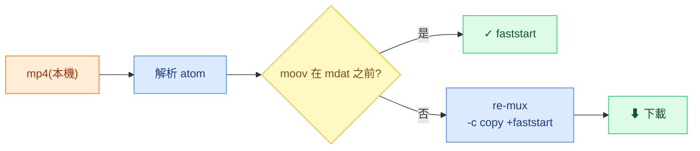

# 🔬 Atomscope

**[English](README.md) · 中文**


> 檢視 mp4 的 atom 結構、判斷是不是 **faststart**,並一鍵 re-mux 加上 **`+faststart`** —— **全程在瀏覽器、檔案不上傳。** · **線上 demo:** <https://atomscope.vercel.app/>

## ✨ 亮點

- ⚡ **一鍵 `+faststart` re-mux,全在瀏覽器** —— 真的 ffmpeg.wasm,`-c copy`(無損)、**零上傳、零後端**。
- 🔍 **看得出影片「為什麼不能串流」** —— 頂層 atom 順序(`ftyp/moov/mdat`)+ `moov` 位置 + faststart ✓/✗ 判定。
- 🧠 **設計取捨,寫清楚** —— Vite SPA 而非 Next.js、單執行緒 WASM(免 COOP/COEP)、純前端 —— 每個都是真取捨(見下)。
- ✅ **production-grade,不是玩具** —— TS strict · ESLint/Prettier · husky hooks · Vitest · Lighthouse · GitHub Actions CI。



## 快速開始

```bash
npm install
npm run dev      # 開發伺服器
npm run build    # 靜態打包 → dist/
npm test         # 單元測試
```

## faststart 的原理

`moov` 是播放器解封裝(demux)必需的索引(軌道、時間軸、每個 frame 的 byte 位置)。當 `moov` 在 `mdat` **之前**,播放器讀前幾 KB 就拿到索引,再用 **HTTP Range Request** 只抓當下要播的片段 —— 不必整支下載。`+faststart` 只是把 `moov` 搬到檔頭(封裝後處理、不重編、音視訊內容完全不變)。

## 設計取捨

<details>
<summary>為何 Vite SPA(而非 Next.js)· 單執行緒 ffmpeg · 純前端 · v1 刻意不加 AI</summary>

- **Vite SPA,而非 Next.js** —— 100% 客戶端;Next 的 SSR/SSG/RSC/SEO 價值用不到,只會多一個 server runtime + hydration 成本。_反例:_ 需要動態 OG/SSR → 才用 Next。
- **單執行緒 ffmpeg.wasm** —— 多執行緒要 `SharedArrayBuffer` + COOP/COEP,讓靜態部署複雜化;`-c copy` re-mux 夠快。
- **`-c copy`** —— 只搬 `moov`、不動 bitstream → 快、無損。
- **純前端、不上傳** —— 隱私 + 零後端。_代價:_ 大檔受瀏覽器記憶體上限。
- **v1 不加 AI** —— 雲端 AI 要 key/後端,會破壞純前端。未來可用端側 WebGPU LLM 解說報告,仍保持零後端。

</details>

## 品質與 CI

| 面向  | 工具                                                          |
| ----- | ------------------------------------------------------------- |
| 型別  | TypeScript strict                                             |
| Lint  | ESLint 9 · Prettier                                           |
| 測試  | Vitest + v8 coverage(atom 解析器)                             |
| Hooks | husky —— pre-commit `lint-staged` · pre-push 測試             |
| 指標  | `npm run metrics:size` · `npm run metrics:lhci`               |
| CI    | GitHub Actions:format → lint → test → build → size(push / PR) |

---

<sub>**技術棧:** React 19 · TypeScript · Vite 6 · `@ffmpeg/ffmpeg`(單執行緒 WASM)。**限制:** 只解析頂層 atom · 僅 mp4 · 大檔受瀏覽器記憶體上限。</sub>
